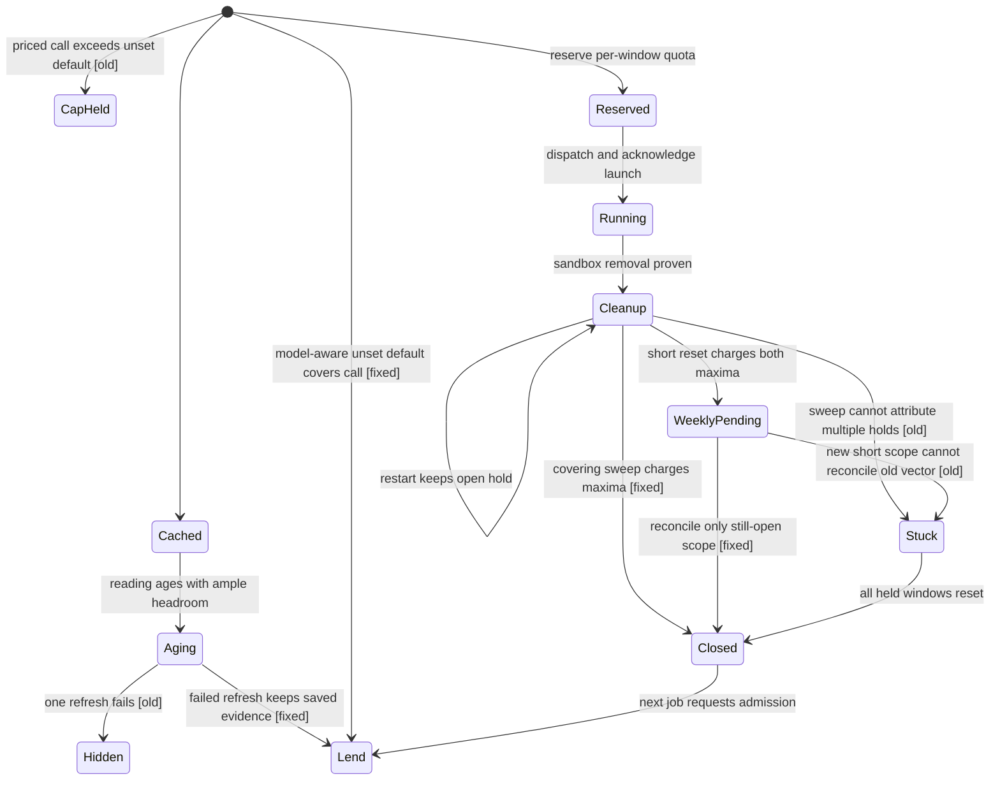
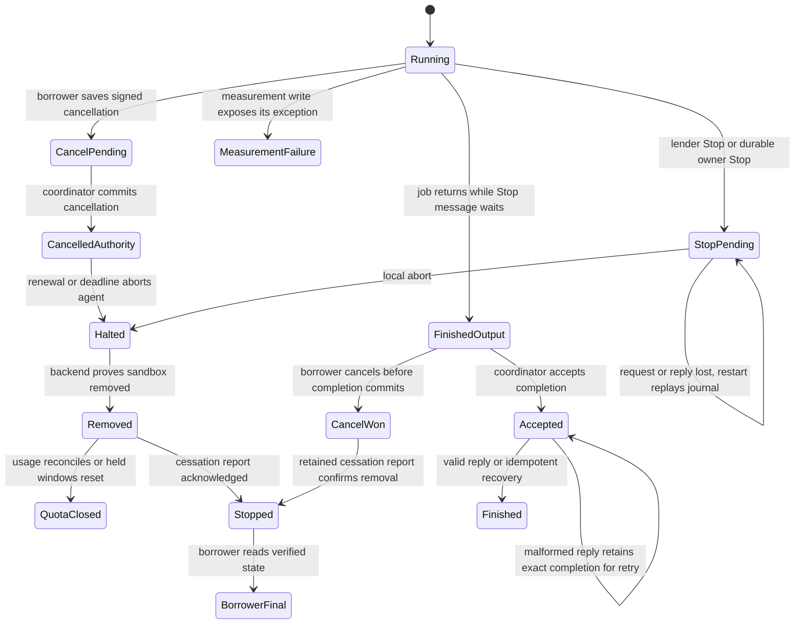

# Protocol models (TLA+)

These models check two protocols for paths that tests do not think to try.
A model counts only when TLC finds a path and a test in `tests/protocol-replay/` then shows the same path in the real code.

| Model | Code it describes |
|---|---|
| `LendingLease.tla` | Lease, launch fence and try counting: `lib/v1/store.mjs`, `lib/v1/lender.mjs`, the guest watchdog and launch ack in `lib/docker-backend.mjs` (fix/launch-fence-1101, b4f581f2) |
| `Hosting.tla` | Primary-circle start, stop and app-start resume: `lib/host.mjs`, `lib/v1/host.mjs`, `lib/v1/host-command.mjs`, `lib/v1/host-intent.mjs`, `lib/v1/coordinator-owner.mjs` (fix/batch8b-server-1101, **57712e0115584d4d00bc9af59f79cf904f309f10**) |
| `Admission.tla` | Lending admission and durable quota holds: `lib/v1/lender-pace50.mjs`, `lib/v1/lending-policy.mjs`, `lib/v1/lending-pace50-source.mjs`, `lib/v1/lending-runtime.mjs` (citations at a9f7bdf7; `Fixed` follows 73cab697) |
| `NativeGuard.tla`, `NativeGuardStop.tla` | Timed native spending and the cessation contract with Stop: `lib/v1/lending-native-guard.mjs`, `lib/v1/lender.mjs`, `lib/faravan-guard.mjs` (e035f188) |
| `Stop.tla` | Borrower cancel, lender and owner Stop, and completion delivery across both computers: `lib/v1/lender.mjs`, `lib/v1/client.mjs`, `lib/v1/store.mjs`, `lib/v1/state-projection.mjs` (73cab697) |
| `ClaimCancelStop.tla` | Claim-time admission, the borrower-or-steward cancel front door, and the two Stop observations: `lib/v1/lender.mjs`, `lib/v1/account-execution.mjs`, `lib/v1/store.mjs` (design 1119 items 3 and 4; replayed by `tests/account-claim-time-admission.test.mjs`, `tests/cancel-front-door.test.mjs` and `tests/stop-statechart-paths.test.mjs`) |

The assumptions and reviewed boundaries of each model are in its opening comment. Hosting's current process model replaces the old B1–B7 abstraction.

## Run

```sh
npm run protocol:check                       # every check, about 6 minutes
npm run protocol:check -- --only=Hosting_h1  # one check
npm run protocol:replay                      # replay tests (they fail while their bug is open)
```

`protocol:check` needs Java 11 or later. It runs TLC outside the test sandbox.
Each `.cfg` file is one check, with fixed bounds. Its first line states the expected outcome.
`Admission.cfg` and `Stop.cfg` are shared by a sweep of scenarios instead: `scripts/protocol-check.mjs` lists each scenario with its constants and expected outcome.
The expected outcome is one of:
- `pass`: no violation.
- A property name: TLC must find that property violated. This marks a known open bug, a variant that drops an assumption, or a reachability witness.

The script exits 1 when any outcome differs from what is expected. A failed check writes TLC's full output, including the trace, to `~/.tmp/tla/<check>.out`.

### tla2tools.jar

The jar is never stored in the repo. The script downloads it to `~/.tmp/tla/tla2tools.jar` if it is missing, and it checks the jar's checksum each time it runs:

- URL: https://github.com/tlaplus/tlaplus/releases/download/v1.8.0/tla2tools.jar
- TLC version printed: 2026.10.30 (rev 090e85c)
- sha256: `011267fca25d0752cf18894dd585cd28b96960c112ea8a20b823ea770e7e10cd`

To download it yourself:

```sh
mkdir -p ~/.tmp/tla
curl -fsSL -o ~/.tmp/tla/tla2tools.jar https://github.com/tlaplus/tlaplus/releases/download/v1.8.0/tla2tools.jar
sha256sum ~/.tmp/tla/tla2tools.jar
```

`TLA2TOOLS_JAR=<path>` selects another copy. That copy must have the same checksum.

Java runs with `-Xmx1200m -XX:MaxDirectMemorySize=400m` and 4 workers. A full run peaked at 1.47 GB resident.

## Per-job isolation admission

`LendingLease` separates preparation from the deterministic isolation pass. Each lender's
`isoPass` starts false on claim, becomes true only in `IsolationPass`, and is required by
`Start`. Crash/restart clears the volatile bit. The ghost `att[g].isoPass` retains a
passing generation's history so `I5_IsolationBeforeRun` also covers agents still running
while their lender is down. `LendingLease_isolation_skip` removes the guard and must
violate I5; the reach configuration must reach an agent run after a pass.

## LendingLease: time constants

Time is counted in ticks. Each check keeps the inequalities the code relies on, not the exact seconds:

| Constant | Code | Inequality |
|---|---|---|
| `Lease`, `MaxLease` | `lease_seconds`; `MAX_LEASE_SECONDS` 300 | the fence bound is `lease_expires_at + wall + MaxLease` |
| `Wall` | the job's `wall_seconds` | |
| `Kill` | guard stop window, 32 s past the sandbox deadline | `Kill <= MaxLease` |
| `Behind` | the proof date may be up to 300 s old | `Behind <= MaxLease` |
| `Ahead` | the proof date may be up to 60 s ahead | `Ahead < MaxLease` |

The fixed bounds are: Lease, MaxLease, Wall, Kill = 1; Ahead = 0; Behind = 1; Expiry = 5; MaxNet = 2 (observations in flight); MaxGen = 2 (tries per job); 2 lenders, one of which may crash and restart.

## Properties

- **I1** never two sandboxes executing.
- **I2** a job never exceeds max_attempts, and every real start counts as a try. The checks split this into I2a (runs ≤ max), I2b (each run is counted), I2c (`attempts_started` ≤ max) and I2d (at most one run; this follows from T21).
- **I3** never stuck. I3s says every claimed job has a deadline. `_live` checks liveness under fair time.
- **I4** a stale lender never completes, or changes the job, for a newer try.
- **H1** after the latest owner's stop succeeds for a home, that home does not serve and its intent is not true, until another explicit start is requested.
- **H2** every serving process uses committed state in its own home, unconditionally on `host_wanted`. This is an abstraction-consistency invariant, not an independent proof of the child's store selection. The separate `H2_OneCommittedHome` also checks global single-home storage, which explicit overrides do not guarantee.
- **H3** stop signals only verified same-home processes (atomic identity-check/signal abstraction; the final OS PID-reuse race is excluded).
- **H4** one resume per app start; conditional liveness for an actually spawned resume, absent disruption and lock-wait exhaustion. This is not an unconditional availability claim.
- **H5** at most one **live** coordinator per `(home, circle)`, counting pre-bind startup children as well as serving processes.

## Limits: what these models do not show

A passing check means TLC found no path that breaks the property inside the model. It does not show that the shipped code has the property. An independent fidelity review (2026-11-01, at e53d44fb) found these gaps:

- **No allowance and no owner stop.** `LendingLease` has no reservation, charge, refund, consent revocation or lender stop. Its `Stop` is cleanup after a lease or failure, not the lender's own stop. I2a and I2d count launched generations; they do not show one run per job against an allowance.
- **Hosting is bounded and partial.** `Hosting` now follows `lib/v1/host.mjs` on this branch (see the action-to-code map below), with per-home locks and separate processes, so it can show two live coordinators. It still bounds requests (2) and app starts (1), and the checked configurations restrict requests to the app-resolved home (`DirectHomes = FALSE`): with explicit CLI homes on, TLC did not finish in 300 s. Child startup, parent-death cleanup and status publication are modeled from reading the code, not from a replay.
- **H2 counts committed homes, not running coordinators.** H5 is the check for running coordinators.
- **Launch, observation and cleanup are assumed.** A3–A6 assume the guest watchdog, the launch ack, ordered durable writes and proven cleanup. The lender's unsupported-observation branch has no model path.
- **I3 is not "no job lost".** I3 holds when a job leaves the claimed state by failure or expiry, with no useful work, accepted output or settled allowance.

Treat the results below as bounded regression checks for the paths they name, not as proof about the shipped protocol.

## Results (2026-11-01)

| Check | Expect | Distinct states | Time |
|---|---|---|---|
| LendingLease | pass | 2,077,114 | 34 s |
| LendingLease_tries2 | pass | 2,130,838 | 33 s |
| LendingLease_escape | pass (the launch ack covers an escaped watchdog) | 2,302,345 | 35 s |
| LendingLease_live | pass (I3) | 2,077,114 | 86 s |
| LendingLease_counter | I2c violated: the pre-fix counting model (shipped store ignores a stale observation; replay `I2c` passes) | 78,014 | 1 s |
| LendingLease_noack | I2b violated (variant: no launch ack) | 88 | 0 s |
| LendingLease_noack_i1 | pass | 2,534,436 | 43 s |
| LendingLease_noack_escape | I1 violated (variant: no ack and no watchdog) | 91,996 | 1 s |
| LendingLease_reach_* | witnesses violated (the main check is not vacuous) | 7,535–7,989 | 1 s |

## Open violations and their replays

1. **I2c** (fixed in shipped code, with an open question): a late observed-start pushes `attempts_started` past `max_attempts`.
   - Trace: L1 claims and its start is authorized. Its observed-start is delayed. L1 crashes; on restart it releases and reports /stopped, and the job is queued with 0 tries. L2 claims and its start is authorized. L1's late observation counts a try (1 of 1). L2's observation is accepted too (2 of 1), and L2's agent runs.
   - Shipped: a late observation for an attempt that has a stop report and is no longer the job's current attempt spends no try (store.mjs `observeExecutionStart`). A late observation on a fenced attempt with no stop report still spends one try, and so does a stopped attempt that is still the current one.
   - Open question: the fix assumes that a stopped attempt whose observation arrives late did not run its agent. The TLA model does not show that. If the agent did start before the stop, a second run can start with max_attempts 1. The same overrun also remains when the fence ends by its time bound with no stop report and a newer attempt has already claimed the job (`LendingLease_counter` still models that).
   - Replay: `lending-lease.test.mjs`, "I2c: a late observed-start of a stopped attempt does not spend a try of the job's newer attempt". It fails on the pre-fix store.

## Hosting: current model and verification status

TLC results for this revision (2026-11-01, 4 workers, 300 s limit per check). All five match their expected outcome.

| Check | Outcome | Distinct states | Time |
|---|---|---|---|
| Hosting | H5_UniqueLiveCoordinator violated (18-state trace, below) | 4,912,135 | 35 s |
| Hosting_gencheck | pass | 9,258,240 | 67 s |
| Hosting_h1 | H1_StopSticks violated | 4,901,828 | 34 s |
| Hosting_h4 | pass | 4,803,072 | 187 s |
| Hosting_unreadable | H2_OneCommittedHome violated | 789,948 | 5 s |

`Hosting_h4` uses most of the time limit; a busy machine can push it over.

| Configuration | Expected outcome | Purpose |
|---|---|---|
| Hosting | H5_UniqueLiveCoordinator | Expose the split-launch/live-child counterexample, not hide it behind scalar occupancy |
| Hosting_gencheck | pass | Current generation checks plus H2 abstraction consistency, signal safety and no resume loop; does not claim H5 |
| Hosting_h1 | H1_StopSticks | A pre-bind child not yet recorded can survive a successful quiet-port stop |
| Hosting_h4 | pass | Current resume wait with conditional liveness; excludes generation changes, wait exhaustion and disruption |
| Hosting_unreadable | H2_OneCommittedHome | Unreadable app ownership with legacy discovery disabled; second-home provisioning can reuse C |

All five configurations use the current generation check and resume wait, and none enables `DirectHomes`.
The historical GenCheck=FALSE / WaitResume=FALSE switches remain comparison
options, not claims about this revision. The old H1/H4 replay tests exercise
the fixed delayed-resume and held-lock cases; they do **not** replay the new
split-launch counterexample.

### State and bounds

There are exactly two homes (A, the app coordinator directory; B, a representative
legacy/alternate directory), two ports, two operation slots and two process
slots. Every process record has a pid, incarnation, home, circle, port, liveness,
phase and committed-state home. A slot may be reused for two incarnations.
Each configuration permits two requests and one app start. **lock[home]** is a
per-home function; **occupancy[port]** identifies a listening pid or an unrelated
program. These shapes allow two live children in one home and simultaneous
operations in different homes; there is no uniqueness precondition on launch.

The main and gencheck configurations let explicit CLI home choices target
either home. Other configurations restrict requests to the app-resolved home
to isolate their scenario. The resolver separately models explicit override,
owned-circle matches/conflict, and stable-default legacy fallback/conflict.
Unreadable ownership empties the owned-circle set; it does not bypass fallback.
The unreadable configuration disables fallback, representing a channel or
explicit app-home situation, and can then provision the same circle in A while
B retains its committed state.

Naming, provisioning, old-status removal, child launch, bind, serving, signed publication and final
intent persistence are separate steps. A crash can interrupt each boundary.
An unknown tunnel origin permits listening before naming/provisioning, but
listening is not serving a circle. Only an owner's successful start writes
host_wanted=true; an automatic resume preserves intent. Stops always advance
generation, clear intent only for an owner's stop, recheck captured ownership
after tunnel shutdown, wait for exit and then inspect/stop verified listeners
at the configured port. A busy foreign listener makes stop fail, never signals it.
An initially quiet port returns immediately; an initially busy port succeeds only
if this sweep signalled a verified listener and the later probe is quiet. A foreign
listener disappearing without a verified signal does not change failure to success.

The single-circle abstraction omits additional-circle router replacement,
tunnel ownership details, explicit port-option refusal, supervisor scheduling,
and multiple bind addresses sharing one numeric port. It assumes successful
store provisioning and signed publication validate identity. H2_ServingCommitted
is therefore an **abstraction-consistency invariant**: Serve requires committed
local state and assigns stateHome from home, while committed state only grows.
It does not independently establish that the actual child chooses the correct
store, and a passing check must not be presented as that proof. The child startup
implementation behind startServer is outside the reviewed read scope.
Consequently the two-child trace is a **candidate product bug at that boundary**,
not evidence that two processes can both bind or serve. The requested literal
live-process invariant is intentionally stronger than exclusive serving.
Small finite bounds do not themselves establish that TLC finishes in its time
budget; the owner run must establish that too.

### Action-to-code map

Every action also carries its citation in Hosting.tla. Line numbers refer to
the reviewed SHA above; environmental actions model the indicated caller/seam
boundary, not an unreviewed OS implementation.

| Model action/helper | Code and meaning |
|---|---|
| Init | lib/v1/host.mjs:17-29,201-214,249-251: durable config, provisioning and intent snapshots |
| Resolve | lib/host.mjs:26-47,52-55,61-80: override, owned matches, stable legacy fallback |
| NewOp, OwnerStart | lib/v1/host-command.mjs:15-24,34-49; lib/host.mjs:27-28: detached command and pinned home |
| AppStart | lib/v1/host-intent.mjs:13-29: one resume with observed generation |
| AppDown | lib/v1/host-command.mjs:44-49: detached child can outlive app |
| RequestStop | lib/v1/host.mjs:337-363: owner stop vs intent-preserving maintenance stop |
| Acquire, ResumeTimeout | lib/v1/host.mjs:137-150,347: per-home locking and bounded resume wait |
| Prepare | lib/v1/host.mjs:154-167,311-318: under-lock generation/intent fence |
| CheckPort | lib/v1/host.mjs:168-177; lib/v1/coordinator-owner.mjs:116-149: occupied-port AND recorded-owner adoption |
| NameCircle | lib/v1/host.mjs:201-212: persist circle/origin before provisioning |
| Provision | lib/v1/host.mjs:33-60,213-214: local committed state |
| ClearStatus | lib/v1/host.mjs:229-232: remove previous status before a new child, separately crashable |
| Launch | lib/v1/host.mjs:226-235,270-278: startServer precedes waitReady; initial launch is unfenced under parent lock |
| Announce | lib/v1/host.mjs:285-296,330-331; lib/v1/coordinator-owner.mjs:116-140: abstract child status write |
| Bind | lib/v1/host.mjs:232-237: startServer/waitReady environment; listening is not readiness |
| Serve | lib/v1/host.mjs:213-218,235-247: abstract serving of provisioned state |
| ReadyForOrigin | lib/v1/host.mjs:235-239: unknown origin learned after listening |
| StartReady | lib/v1/host.mjs:240-252: signed publication/invites, owner-only intent write |
| StartFailure | lib/v1/host.mjs:253-260; lib/v1/host-command.mjs:78-119: owned-handle cleanup, not adopted-host cleanup |
| StopIntent | lib/v1/host.mjs:341-363: expected-owner check, generation/intent write |
| StopSignal | lib/v1/host.mjs:364-383; lib/v1/coordinator-owner.mjs:106-149: recheck and verified signal |
| StopObserve | lib/v1/host.mjs:370-383: wait for death; signal alone is not success |
| StopPort, VerifyPort | lib/v1/host.mjs:384,396-422: verified same-home listener cleanup and quiet-port success |
| ProcessExit | lib/v1/host.mjs:85-89,370-383: asynchronous effect of TERM |
| OpCrash | lib/v1/host-command.mjs:44-49,93-114; lib/v1/host.mjs:253-260: abrupt death need not clean child |
| HostCrash | lib/v1/host.mjs:64-73,300-305: environment crash, no modeled supervisor restart |
| ForeignTakes, ForeignLeaves | lib/v1/host.mjs:169-177,409-422: unrelated listener environment |
| Done, Phase | lib/v1/host.mjs:260,386: local control state/finally unlock |

### Duplicate-live interleaving (H5)

TLC's counterexample for `Hosting` is this trace: AppStart, OwnerStart, then op 1 (the owner's start) runs Acquire, Prepare, CheckPort, NameCircle, Provision, ClearStatus and Launch, and crashes (OpCrash) with its child not yet bound. Op 2 (the app's resume) then runs the same seven steps on the same home and launches a second child. Both children are live for (A, C). No replay test reproduces this in the code yet. A fix must not weaken the coordinator identity check; `Hosting` is the failing check it should turn into a pass.

The numbered steps below map the trace to the code.

1. C is named and provisioned at A. Launcher L1 holds lock[A]
   (lib/v1/host.mjs:148-150) and finds its port free (169-177).
2. L1 clears old status (lib/v1/host.mjs:230), then calls startServer, creating child P1; P1 has not bound yet. The call and
   subsequent waitReady are distinct (232-235). Launches under the host
   lock have no restart-generation fence (270-278).
3. L1 dies abruptly, without the ordinary catch cleanup (253-260). Its lock
   is freed, but child cleanup is not established merely by launcher death
   (lib/v1/host-command.mjs:93-114).
4. L2 acquires the same home lock. Its port probe is still false, so the
   short-circuit occupied && hostProcessExists(previous) does not examine P1
   (lib/v1/host.mjs:169-172).
5. L2 calls startServer (229-233): P1 and P2 are both live startup children
   naming (A,C). H5 fails before either is required to serve. The model's
   bind exclusivity still prevents both from owning the same port.

The corresponding H1 hand trace replaces step 4 with an owner's stop while
P1 has not written status or bound: it records false/generation (361), sees
no recorded live child (364-368) and a quiet port (401-408), then reports
success. P1 later binds and serves committed state without another hostV1
resume check. This remains conditional on the same unreviewed child boundary.

To confirm or refute either product-level trace, inspect the actual child and
startServer lifecycle for pre-bind uniqueness checks, parent-death cleanup and
the order of status publication.

## Admission: quota holds after a lent job

The model follows one job from admission through reserve, launch, cleanup, restart and the 30-second recovery sweep. `Scenario` picks the case and `Fixed` picks the release rule. `Fixed = FALSE` is the rule at a9f7bdf7. `Fixed = TRUE` is the rule since 73cab697, which charges the covered maxima after cleanup and reconciles only the scopes still open.

On a9f7bdf7, TLC found four broken rules, and each path also failed in the real code:
- **CacheContinuity:** one failed refresh after a good reading hid usable quota (`refresh_failed`).
- **DefaultCoversCall:** an unset per-job cap refused an expensive priced model (`budget_too_small`).
- **CoveredSweepCloses:** with two open holds, or after a short-window reset, the sweep did not close a cleanup-proven hold.
- **IdleEventuallyLends, CleanupCloses:** the matching liveness rules failed.

The model also corrected the first diagnosis. A periodic recovery trigger does exist (`lending-runtime.mjs` calls `probeHeld` every 30 s); the narrow release rule was the cause. The original scenarios pass with `Fixed = TRUE`. The `Admission_old-*` checks keep the old rule as witnesses that the model still finds these bugs.

### Cancelled refresh before start (e035f188)

Saved quota windows and the latest probe outcome are separate facts. A shared background read can be in flight while reserve admits from saved windows. Reserve's `finally` invalidates shared reads (`lender-pace50.mjs:1318,703-707`). An aborted probe stores `cancelled` as its latest result without replacing the successful windows (`lending-probe.mjs:296,362-363`). Before this fix, the cache attached that outcome to saved windows (`:417-423`), and the real source retained both (`lending-pace50-source.mjs:216-237,319-333`; base e035f188).

In the old rule, the first check accepts the saved windows. Pre-start `admitStart` instead calls `observationHold`, which returns `cancelled`; `declineCodeFor` falls through to `quota_unknown` (`lender-pace50.mjs:1367-1381,548-551,60-69`). The lender refuses dispatch (`lender.mjs:983-993`). The replay isolates reserve's `finally` as sufficient to cause this path. Timestamps alone cannot identify the call that aborted the incident reads.

`BeginRead`, `InvalidateRead`, `FirstCheck`, `PreStartRead` and `PreStartCheck` model those boundaries. Pre-start samples the cache before awaiting funding. Invalidation may happen before or after this sample. It cancels shared background reads, not the unshared pre-start read (`lender-pace50.mjs:634,648,707`). `started()` runs only after pre-start succeeds (`lender.mjs:996-997`), so its invalidation cannot abort the same job's preceding check. Reserve's `finally` completes before reserve returns. A pre-start failure in 2 ms can inherit cancelled detail without its own signal being aborted; the replay asserts this. This fits the reported Mac and Linux timings but does not establish their runtime call stacks.

`cancel-first` cancels before the first check; `cancel-start` permits cancellation between checks, including while the pre-start source awaits funding. The fixed implementation stores the successful read's provenance separately from `latest_attempt` (generation, start, end, outcome and reason). Failed attempts do not refresh the windows' timestamps. Cancellation and transient failures keep the saved evidence; invalidating failures make it unusable until a successful refresh. Unknown failures fail closed. A newer successful read supersedes a sampled candidate observation. Infrastructure failures (`guest_failed`, `sandbox_start_failed`, `probe_unavailable`, `history_write_failed`) are transient: they say nothing about the saved quota. A rejected local probe promise also preserves saved evidence and any existing invalidation latch. Provider HTTP 5xx already maps to transient `provider_error`; other HTTP errors remain invalidating.

`usableAdmissionEvidence` checks the same proofs, age allowance and reset coverage at both admission boundaries. The durable policy still checks compatible bindings and prices the job against the remaining headroom, including its age reserve. Pre-start replaces only its own reservation and checks time, current controls, state and latest outcomes again after awaiting the preview. When a successful reading supersedes the sample, or state or controls change across the preview await, pre-start resamples and evaluates again, up to three passes. Each pass binds identity, epoch, account week and plan to the original reservation. Owner hold, lost launch authorization and an already-started handle refuse immediately. Three changing passes refuse with `controls`; a successful pre-start reply has no decline reason. Fresh-read requirements for live guards and settlement are unchanged.

`CancelSafe = FALSE` retains the old cancellation refusal as an expected `CancelledCacheContinuity` violation. `CancelSafe = TRUE` uses the shared class mapping and usability rule. Saved evidence can be usable, stale or invalidated; latest attempts can be good, cancelled, transient, invalidating or unknown. Age and invalidating outcomes can change the evidence before or between checks. `DispatchImpliesUsable` forbids dispatch with unusable evidence; `GateAgreement` compares the answers only when inputs are unchanged; `TransientKeepsEvidence` checks that a transient outcome does not change saved evidence; `InvalidatingRefusesBoth` checks both boundaries. `RecheckSafe = FALSE` retains the round-2 refusal on supersession and unrelated revisions as expected `UsableChangeStillAdmits` violations, and its infrastructure classification as an expected `TransientKeepsEvidence` violation. `RecheckSafe = TRUE` passes all properties in those three scenarios. `NewerSuccessfulRead` and `UnrelatedStateRevision` model changes during pre-start; the final check abstracts a stable re-evaluation. Repeated churn and the three-pass bound are covered by the implementation replay. The model stops changing evidence after the start decision: it models admission, not the live guard. It also checks that both decisions finish, including refusal paths.

`tests/lending-admission-cancel-race.test.mjs` uses the real candidate, source, readings, probe and ledger, with fixture transport, host proofs, calibration and owner-demand inputs. It checks cancellation, timeout, network failure, authentication failure and unknown provider output at both boundaries, both pre-start sample orderings and two shared subscribers. Stale and full windows refuse with the existing quota-reserve code. The old refusal witness and the three TODO cases have been replaced by passing assertions. Round-3 replay also checks all infrastructure reasons, thrown runner and ledger failures, compatible successful reads on both sides of the preview await, changed account or plan, unrelated meter feedback and coverage receipts, and repeated revision churn. Separate mutation runs restore invalidating `guest_failed` and refusal on revision change; the replay must fail for each mutation.

Other cancellation/deferral evidence boundaries (base e035f188; code sites, not claims that each is a bug):

| Site | Effect |
| --- | --- |
| `lending-probe.mjs:264` | Close overrides the latest result with `closed`. |
| `lending-probe.mjs:292,296,302,311,317,362,375-377` | Abort or cancelled runner outcomes become failed latest/caller results. |
| `lending-probe.mjs:430` | An already aborted caller gets failed cancellation with its saved snapshot. |
| `lending-probe.mjs:441` | A running account without its meter session gets deferred `account_busy`. |
| `lending-probe.mjs:452-455` | Cadence preserves the latest failure, including cancellation; prior success becomes deferred `probe_deferred`. |
| `lending-probe.mjs:460-466` | Cancelled/closed probes or aborted callers get failed cancellation while saved windows remain. |
| `lending-pace50-source.mjs:203-205,213,219,225,265,270,276` | Aborted sources return empty resources and unknown proofs. |
| `lending-pace50-source.mjs:226-235` | Deferral or failed non-admission refresh yields empty resources and unknown proofs. |
| `lending-pace50-source.mjs:360-361` | Policy refuses deferral or failed refresh before checking other evidence. |
| `lender-pace50.mjs:619-631,643-648,665-672` | Abort, shared generation invalidation or deadline yields an empty cancelled observation. |
| `lender-pace50.mjs:548-551,1368-1369` | Pre-start treats attached cancellation/deferral as a hold. |
| `lender-pace50.mjs:1425-1427` | Live recheck defers busy/deferred feedback and keeps the hold. |
| `lending-native-guard.mjs:106-117` | Failed/deferred reads are unusable; the last usable reading's stop deadline remains armed. |
| `lender-pace50.mjs:267-269,940-949,1502,1665` | Fresh-reading consumers cannot use failed/deferred reads for settlement or recovery. |
| `lender-pace50.mjs:845-846,1603` | Feedback and finish reconciliation require a complete successful refresh. |
| `lending-policy.mjs:707,832,1039,1109,1161,1306` | Durable proof gates reject events whose refresh failed, including cancelled/deferred evidence. |
| `lending-runtime.mjs:148-151` | Capacity reporting treats deferred/failed readings as unavailable evidence. |
| `lending-readiness.mjs:9-15` | Readiness treats deferral as unseen evidence and marks proofs unknown. |

Lifecycle invalidations in `lender-pace50.mjs`: reserve `:1318`, meter feedback `:1470`, acknowledged start `:1491`, finish `:1526`, release `:1627`. Shutdown `:701-702` also cancels unshared/meter entries.

Replays: `tests/lending-admission-statechart-paths.test.mjs` runs each path against the real source, candidate, policy and durable adapter, with synthetic provider readings. It closes and reopens the adapter to test restarts.

Limits: this is a scenario quotient, not an arithmetic replica. One short and one weekly window stand for the scope tuple. Holds use small units, and prices, headroom and identity are preconditions that the replays check. The model leaves out malformed state files, fsync failures, concurrent writers, late-start chains and overshoot amounts.



## Stop: cancel, Stop and completion delivery

The model has one started job, two computers and a durable coordinator. `Kind` picks borrower cancel, lender Stop, owner Stop, a finish while Stop is in flight, a cancel racing completion, a malformed reply, or a measurement write. `Fault` drops one request or one reply. `RestartPeer` restarts the borrower or the lender once. Fairness covers durable sends, handling, recovery, sandbox removal and quota settlement. It does not cover a peer that never returns or a disk that always fails.

Three rules hold in every Stop, cancel, loss and restart scenario: the sandbox is eventually gone, the hold eventually closes, and Stopped is never shown before removal is proven. The delivery and measurement regressions now expect `pass`:
1. **Malformed completion reply:** a bad HTTP 200 body or completion ACK shape has an unknown outcome. The lender retains the exact signed result and operation key for retry (`Stop_malformed-*`). After three consecutive malformed recovery replies, it saves the result locally, reports that delivery is unconfirmed, and allows other jobs to run.
2. **Cancellation during delivery:** completion and cancellation still serialize at the coordinator. If cancellation wins, the lender retains the output locally and shows Stopped. A cessation obligation is saved with the completion intent, so rejection or restart cannot discard it (`Stop_cancel-race-none-none`).
3. **Measurement failure:** a sink exception increments the capture failure counter and lending continues (`Stop_measurement-none-none`). The counter is available through `candidate.measurementStatus().failedWrites`.

Replays: `tests/stop-statechart-paths.test.mjs` uses the real signed client, request checks, server handler and SQLite coordinator for both computers, with a fake backend. Reply corruption runs after the coordinator commits. All fourteen original cases pass with no `todo` marks. A fifteenth case checks graceful lender Stop: the partial result remains available, cessation is reported, and the borrower status says Stopped by lender. That extra path is tested in code, not represented separately in the model.

Limits: one generation, a bounded transport, and at most one restart per peer. The model leaves out a coordinator restart, simultaneous crashes, source upload races, approval before start, UI routes, signal delivery and watchdog timing.




## NativeGuard: timed Stop and spending (2026-11-03)

`NativeGuard.tla` supplies the timed cessation contract missing from `Stop.tla`.
It starts with one running job and one window. `NativeGuardStop.tla` composes
the one-job lender-stop slice: RequestStop
synchronizes LocalStop, transport stutters while the backend runs, and
halted/gone transitions require ActualCessation. This is an explicit interface
assumption, not a refinement proof of the code. StopDelivered supplies no
cessation fact. No product code changes.

The clock ranges from 0 to 6. F=2 is freshness, P=2 is the longest interval
before an evaluation or stale stop, L=1 is reporting lag, T=1 is decision-to-end
latency (also the assumed watchdog bound after host crash), R=1 is borrower
burn per tick, q=1 is reading uncertainty, Batch=0,
allowance=6 and quota Q=30. Owner use accrues at one unit per tick. Borrower
use accrues while actually running, including after delivery. These small
integers preserve relationships; they do not assert provider rate or OS bounds.
Tick cannot pass a due timer/decision, or a sound cessation deadline. At the
finite horizon the model stutters. Safety checks do not infer real-time
progress from weak fairness.

Eq.17 is `min(Q, measuredHi + ownerEnvelope + borrowerEnvelope)` on the sound
path, with quantization/batch uncertainty added conservatively. Both envelopes
start at coverage time, not receipt time. Without sound envelopes `TotalHi=Q`.
The residual budget is `B_stop=R*T+Batch`; the separate guard margin is
`q+R*(L+P+T)+Batch`. The paper's exposure budget and the code's batched-charge
term both use the letter B; they must not be confused. The 60-second freshness
setting and 120-second settlement delay establish neither envelope soundness
nor process cessation.

| Action | Code at e035f188; environmental boundary where indicated |
|---|---|
| Tick | `lending-native-guard.mjs:54-55,79-82`; injected clock and timer contract |
| PollStart, Hang, PollFail | `lib/v1/lending-native-guard.mjs:92-108`; pending provider promise may never answer |
| PollComplete | `lib/v1/lending-native-guard.mjs:101-107,113-135,165-204`; trusted coverage and post-halt check |
| TimerFire, RequestStop | `lib/v1/lending-native-guard.mjs:65-82`; `lib/v1/lender.mjs:716-746,748-764` |
| StopDelivered | `lib/v1/lender.mjs:735-736,758-761`; acknowledgement only |
| ActualCessation | `lib/faravan-guard.mjs:355-410`; independent backend/group-exit assumption |
| InbandMeter | `lib/v1/lending-native-guard.mjs:138-161`; representative forged low line (high lines may only add Stop) |
| Crash, Watchdog | `lib/v1/lender.mjs:1396-1481`; `lib/faravan-guard.mjs:189-204,396-402`; host timer loss and assumed independent cessation |

Paths above without a `lib/` prefix refer to `lib/v1/`. The model omits window
rebinding, account changes, admission grace for old readings, and settlement.
It does not prove containment, provider behavior, or a universal quota theorem.
`CertificationHonest` checks the threshold claim separately from the residual
latency contract; using the full allowance does not change post-decision R*T.

| Config | Expected result |
|---|---|
| NativeGuardStop | pass: shared cessation-before-cleanup contract, Stop safety and all guard invariants |
| NativeGuard_faithful | pass: types, eq.17, certification label, stale deadline, late-result fence, in-band trust, ACK separation, residual budget, margin |
| NativeGuard_wait | `StaleOnTime` violation: Tick past stale deadline while poll hangs |
| NativeGuard_late | `NoLateRearm` violation: stop then complete old poll |
| NativeGuard_inband | `InbandUntrusted` violation: forged low line changes trusted freshness |
| NativeGuard_ack | `AckNotCessation` violation: delivery claims proof while running |
| NativeGuard_margin | `CertificationHonest` violation: full allowance with a certified claim |
| NativeGuard_uncertified | `ResidualBound` violation: faster burn/delayed cessation; explicitly uncertified |
| NativeGuard_reach | `W_NoStopAfterHang` violation: PollStart, Hang, Tick to F, TimerFire, RequestStop |

Each config is a separate file. The runner requires the named outcome and fails
on an unexpected pass. `tests/lending-native-guard-timed-stop.test.mjs` replays
the hung-read boundary against the real guard with injected timers and a fake
backend. Its independent clock and ledger keep spending through delivery until
actual cessation. Sound terms give 2 units after Stop; unknown terms give 15,
violating the same 2-unit claim. A late result arms no timers; forged low output
moves no trusted timestamp. Host-reading tests check the reduced threshold and
the uncertified soft threshold. Existing `v1-lending-native-round3.test.mjs`
checks that native allowance stops bypass the graceful path. `v1-lender-kappa-feedback.test.mjs` exercises
the real lender's 45-second hung-stop-answer fallback and 10-second return
backstop. Those transport settings are not assumed to certify T.

No new live timer or late-result defect was reproduced. The reproduced hard
safety limitation is the documented soft-cap path: unknown bounds select the
full allowance (`lib/v1/lending-native-guard.mjs:27-41,219-223`), Stop is only a
request (`65-73`), and use continues until the backend actually ceases. A hard
guarantee would require sound bounds and refusal or an explicit uncertified
result when they are absent. This PR records that choice without changing it.

Final focused runs: NativeGuard_faithful explored 1,302 distinct states;
NativeGuardStop explored 40,762. All nine checks matched their expected result;
each finished within one second. The selected Node run passed 65 tests.

The recorded TLC hang witness is Tick(1), Tick(2), PollStart, Hang, TimerFire,
RequestStop at time 2. The Node replay starts its poll at time 2, forges low
in-band output at 3, stops at 4 with the read pending, then delivers the late
result. Actual cessation is at 6 with sound bounds, or 9 without them.


## ProbeOwnership: provider transport and candidate cache generations

Base: `e035f188febab5bc5ba0795813a40ad9381267cd` (`ship`). This module complements Admission's saved-evidence contract without editing Admission. It represents two waiters, one provider probe/controller (id 1), a captured generation, one candidate cache invalidation, per-waiter cancellation/results and a Boolean backoff boundary. Each action cites the base code. `StartGuardRead` also covers a guard owning the transport without a background waiter. Different model/plan keys can share the provider transport; different providers cannot. The replay checks that boundary rather than multiplying the model's state space.

| Action | Code at the base |
| --- | --- |
| Init | `lending-probe.mjs:246`; `lender-pace50.mjs:565-570` |
| StartRead / StartGuardRead | `lending-probe.mjs:285-292`; `lender-pace50.mjs:634-646` |
| JoinRead | `lending-probe.mjs:372,443-459` |
| CancelWaiter / AbortTransport | `lending-probe.mjs:247-254,294-297,373-377` |
| InvalidateCandidateCache | `lender-pace50.mjs:703-707` |
| CompleteOldRead | `lending-probe.mjs:299-310,339-370`; `lender-pace50.mjs:648-652` |
| BackoffExpires / Idle | `lending-probe.mjs:269-281,321-324` |

`Coupled=TRUE` faithfully models the current transport ownership: any subscribed abort signal aborts the single controller. All joined callers then receive cancellation. This contradicts candidate's stated guard isolation contract (`lender-pace50.mjs:601-602`), so the isolation and guard checks intentionally expose live violations. `Coupled=FALSE` is a proposed ownership repair, not shipped behavior: cancelling a waiter aborts transport only when no interested waiter remains. `StalePublish=TRUE` removes the candidate publication fences as an intentional mutant. Cancellation and synchronous abort are split for inspection, but neither joining nor completing may overtake the pending abort.

| Config | Expected outcome | Meaning |
| --- | --- | --- |
| ProbeOwnership | pass | Faithful cache fence, types and coupled-delivery contract |
| ProbeOwnership_isolation | NoCollateralAbort violation | Shipped cancellation aborts another interested waiter |
| ProbeOwnership_guard | GuardNotLost violation | Lifecycle invalidation loses the joined guard result |
| ProbeOwnership_stale | CacheFence violation | Removing publication fences resurrects an invalidated cache/timestamp |
| ProbeOwnership_repair | pass | Proposed ownership repair satisfies isolation, guard continuity and cache fence |
| ProbeOwnership_reach_cancel | W_NoCancelBoundary violation | Two waiters and collateral abort are reachable |
| ProbeOwnership_reach_stale | W_NoInvalidatedCompletion violation | Old completion after invalidation with a guard is reachable |
| ProbeOwnership_reach_guard | W_NoGuardSurvival violation | Faithful unshared guard survives invalidation and completes |

The runner compares exact expected outcomes, including witnesses, and rejects unexpected passes. Each check finishes in approximately one second at these bounds. These are bounded safety checks, not eventual transport/retry guarantees. Backoff is one expiry event, not the real five-minute-to-one-hour sequence. No spend, quota or sound rate envelope is modeled: this cannot establish the lending paper's eq.17, and freshness/settlement product settings are not proof assumptions.

`tests/probe-ownership.test.mjs` uses the real candidate, ledger, probe, readings and real source. Only the runner and clock are fake. Each deferred runner exposes its signal and returns valid success even after abort, separating transport cancellation from cleanup completion. Independent expected outcomes and timestamps are checked at start, join, cancellation/invalidation, late completion and retry. Two expected-defect tests assert the observed divergence from independent guard ownership; they must change when product ownership is repaired. Controls cover successful joins, model-key sharing, provider isolation, backoff expiry, acquisition timestamps and an unshared guard completing across invalidation without republishing into the candidate cache. The ledger may accept valid new guard evidence even when candidate generation publication is fenced.

Finding C is reproduced on both base `e035f188` and PR #238 head `1d1eaf67d05ff6e6b3ab11410e3f7b2b5d59426e`: background read starts, another model's guard joins with its own signal/meter session, background signal or candidate `release` invalidation aborts the transport, guard signal stays active, runner drains, both observations are cancelled. Saved ledger/funding timestamps remain unchanged and the invalidated candidate cache remains empty. PR #238 changes saved-evidence provenance but leaves the lower shared-controller behavior in place. This replay does not claim a real native guard stop or financial loss, nor duplicate Admission's reserve/admitStart replay.

Proposed product fix (not implemented): give each waiter separate cancellation/results, retain a provider-owned controller until all interested waiters cancel, and keep the pending transport registered until cleanup settles. Lifecycle invalidation should cancel its own subscribers and fence cache publication while preserving guard subscribers. App shutdown may still cancel all owners. Preserve provider backoff and generation checks.


## AdmissionFeedback: meter feedback and admission fences

`AdmissionFeedback.tla` follows the feedback paths at ship **e035f188febab5bc5ba0795813a40ad9381267cd**.
It leaves the pre-start recheck work in PR #238 outside its scope. The finite
trace quotient has two resource limits, two attempts (one with represented burn),
two meter generations and two process incarnations. Restart can occur after
feedback/repricing persistence, after the stop request, or after cessation. The unchanged-reading
and rate-surprise responses are separate steps; same-spend triggers can queue while
the first response is pending. Old and current partial-coverage responses branch.
It is a bounded regression model, not an exhaustive transcription of the writer
queue or a liveness proof under arbitrary failures.

### Contracts and assumptions

The Admission interface exports `AdmissionOpen`: a durable feedback block or a
queued control/feedback fence denies admission. Admission supplies sufficient
holds, current-revision reservation and sound per-limit exposure room. Under the
paper's eq.17, that room uses the last measured use plus justified owner and
borrower envelopes, capped at Q; without sound envelopes the upper bound is Q.
This model does not derive those envelopes from historical kappa. `BlindBudget`
checks that an unchanged reading cannot erase already-uncovered liability within
a supplied B=2 budget; it does not prove a physical spend bound for the provider.
The replay checks that cumulative spend and the original exposure cap survive
successive unchanged and surprise cycles, using synthetic rates.

The Stop interface separates `RequestStop` from `CeaseAndRepresent`. Cleanup and
represented usage are trusted inputs from the Stop/settlement boundary; requesting
Stop never refunds a hold. Real OS cleanup, provider reporting coverage and fsync
semantics are outside this model. Feedback persistence and repricing are split for
explanation; no admission or coverage step can interleave between them, matching
the atomic durable transition in the implementation. Captured revision is an
observation snapshot, not permission to commit an admission at that old revision.
Neither `Admission.tla` nor `Stop.tla` is changed or instantiated: their scenario
variables are not a joint quantitative ledger. These are explicit interface
contracts rather than a checked refinement of their complete state spaces.

### Actions mapped to ship

| Action | Source |
|---|---|
| MeterTrigger, BeginRecheck, SameSpendNewMeter, UnchangedReading, Drain | `lib/v1/lender-pace50.mjs:1412-1421,1447-1465,1481-1485`; revision capture at `lib/v1/lending-pace50-adapter.mjs:403-406` |
| RateSurprise | `lib/v1/lender-pace50.mjs:1442-1451` |
| QueueFeedback, On, Admit, TryReserve | `lib/v1/lending-pace50-adapter.mjs:393-426,450-454,481-498` |
| PersistFeedback, RepriceOutstanding | `lib/v1/lending-policy.mjs:795-823,273-279` |
| RequestStop | `lib/v1/lending-policy.mjs:824-828`; `lib/v1/lender-pace50.mjs:95-98,231-235` |
| CeaseAndRepresent | `lib/v1/lender-pace50.mjs:1525-1580`, Stop cleanup and settlement contract |
| Restart | `lib/v1/lending-pace50-adapter.mjs:122-127`; `lib/v1/lender-pace50.mjs:771-778` |
| CoverSubset, CoverAll | `lib/v1/lending-policy.mjs:838-857` |

### Checks and replay

| Property | Intentional mutant config | Faithful boundary witness |
|---|---|---|
| TriggersDrained | `AdmissionFeedback_lost`: drop newer same-spend trigger | `AdmissionFeedback_reachTrigger` |
| BlindBudget | `AdmissionFeedback_renew`: erase blind liability on unchanged receipt | `AdmissionFeedback_reachBlind` |
| CoverageSound | `AdmissionFeedback_coverage`: old or partial roster clears all | `AdmissionFeedback_reachCoverage` |
| FenceOrder | `AdmissionFeedback_overtake`: earlier On clears pending fence | `AdmissionFeedback_reachFence` |
| FenceOrder (durable block) | `AdmissionFeedback_admission`: ignore durable feedback after volatile fence drains | `AdmissionFeedback_reachAdmission` (successful reserve after full coverage) |
| SettledStable | `AdmissionFeedback_double`: reprice represented burn | `AdmissionFeedback_reachReprice` |

All properties pass together in `AdmissionFeedback.cfg` (36 distinct states).
Each mutant violates exactly its named property; each faithful witness violates
its negated reachability predicate. All thirteen checks finish in about one second
per config with the runner's existing memory and five-minute limits. An unexpected
pass is a runner failure.

`tests/admission-feedback-replay.test.mjs` drives real candidate, runtime, durable
adapter and policy modules. Deferred synthetic source responses exercise duplicate
and lower cumulative spend, unchanged readings and a later 3x conversion. An
independent integer-ratio oracle checks outstanding liabilities and unchanged
burn records. Restart reloads the same blocked state. Live liabilities and old
observations cannot clear it; a one-limit roster clears only that limit. A later
conversion leaves settled burn unchanged, and admission resumes only after both
limits clear. A newer-spend replay also changes the meter while an older response is pending.
A separate deferred Stop callback checks queued On against later
Stop and feedback requests. All four tests pass in the network-disabled sandbox.
No live product defect was reproduced by these paths; intentional model mutations
are regression tests, not claims about current ship behavior. The tests do not
establish real-provider envelopes or a quantitative physical B guarantee.

The single full protocol run on 2026-11-03 matched 59 of 60 expected outcomes.
The existing `Hosting_h4` check timed out at 300 seconds under concurrent host
load; all thirteen AdmissionFeedback checks matched. The full runner exited 1.
No full-suite retry was made. GitHub macOS preview jobs did not start because of
account billing/spending limits; this is separate from local verification.


## AdmissionExposure: evidence soundness and per-limit exposure

`AdmissionExposure.tla` separates true owner/borrower consumption, measured use,
reading acquisition and coverage, valid envelopes, per-job reservations and
unrepresented burn. Bounds are two jobs, two fixed resource instances, quota 4,
blind-exposure budget 1 per limit, four owner-spend ticks and two readings per resource.
No reset, crash or optimizer is transcribed. Both limits charge the same unit of
borrower work; B is checked independently for each limit rather than adding its
short and weekly representations.

The contract with `Admission` is explicit in the module: Reserve needs a vector
certificate before persistence/dispatch, KnownUsage transfers held to
unrepresented, Cleanup never refunds consumption, and Sweep needs trusted burn
coverage before reducing exposure. This is an assume/guarantee interface, not a
checked product/refinement of `Admission`'s one-hold quotient. That module remains
unchanged. A sound incremental envelope is an environmental assumption; the
model never learns one from freshness or historical rates. Loss of validity sets
`total_hi = Q`, yielding zero provable room. `RoomSound` records the result at
reservation time, so later owner spending does not retroactively invalidate a
reservation certificate. `ExposureBudget` checks true unreported borrower burn.
The guard's post-start overshoot theorem belongs to its separate lane.

| Config (`AdmissionExposure_` prefix) | Required result | Meaning |
|---|---|---|
| faithful | pass: RoomSound, ExposureBudget | Sound envelopes and trusted burn coverage |
| estimate | RoomSound violation | Promoting the reading-age estimate to a hard bound |
| refresh | ExposureBudget violation | A receipt clears liabilities without covering burn; a second local check passes |
| omit | RoomSound violation | One applicable limit is excluded |
| reach_burst | W_NoOwnerBurst violation | Actual owner use fills Q before an estimated reservation |
| reach_unknown | W_NoUnknownBoundary violation | Invalid envelope with actual consumption is reachable |
| reach_sequential | W_NoSequential violation | Two jobs can spend when actual coverage replenishes B |
| reach_own | W_NoOwnRecheck violation | Replacement excludes only its own reservation |
| reach_coverage | W_NoCoverage violation | Covered burn can leave the blind-exposure ledger |

The runner compares exact outcomes, including unexpected passes. These are
bounded checks, not empirical certification of provider lag or spend rates.

Replay: `tests/admission-exposure-paths.test.mjs` extends the real
candidate/adapter fixture in `tests/lending-admission-statechart-paths.test.mjs`
(the audit abbreviates that filename). A separate clock and true-spend ledger
never call production age/headroom/settlement helpers. It demonstrates:

- An owner burst from 40 to 100 short-window points after a saved reading passes
  both reserve and final admission, with positive held points above true room.
  Unknown envelopes independently yield zero certified room for both limits.
- A reported exhausted short limit refuses despite room in the weekly limit.
- Two native jobs each burn 0.8 points. After each cleanup, a newly acquired but
  unchanged provider aggregate at +121 seconds closes the hold. Actual unreported
  use reaches 1.6 points, above the test contract B=1. The covered-reading control
  replenishes B only when the aggregate includes actual burn. B is a requested
  safety contract, not a shipped product setting. The product charges a one-point
  settlement floor per job; that charge does not prove the provider represented
  the underlying usage.

These are deterministic reproductions of audit finding B's hard-contract gap,
not evidence of observed financial loss. `lending-policy.mjs:1433` uses the
estimate explicitly disclaimed by `lending-reading-age.mjs:5-14`; available room
at policy:1481-1485 uses the saved aggregate. Native settlement trusts elapsed
time at `lender-pace50.mjs:932-935,967-970` and marks a floor charge represented
at `lending-policy.mjs:1178-1186`. A hard-safety variant needs sound envelopes or
an uncertified/refused decision and a durable blind-exposure budget that only
actual coverage replenishes. No product code changes are included.

### AdmissionExposure action contract and traces

All citations below refer to base `e035f188`. The contract is conditional: the
faithful model supplies sound environmental envelopes and trusted coverage.
Current product code supplies an estimate instead; `faithful` is a hard-safety
reference contract, not a claim that the current implementation satisfies it.
The `refresh` mutation abstracts lost blind liability; native code reaches that
boundary by closing a hold and marking a floor represented rather than by a
literal `unrepresented` reset on every probe.

| Action | Code boundary |
|---|---|
| Init | `lib/v1/lending-policy.mjs:567-575`, empty ledger |
| OwnerSpend | `lib/v1/lending-policy.mjs:1425-1434`, external use since measurement |
| BorrowerSpend | `lib/v1/lending-policy.mjs:1011-1037`, held-to-unrepresented usage |
| AcquireReading | `lib/v1/lending-probe.mjs:305-310`, acquisition timestamp |
| DeliverLaggedReading | `lib/v1/lending-probe.mjs:339-363`, publication distinct from coverage |
| LoseEnvelopeValidity | `lib/v1/lending-reading-age.mjs:5-14`, estimate lacks a certified envelope |
| Reserve | `lib/v1/lending-policy.mjs:1425-1434,1481-1504`; `lib/v1/lending-pace50-adapter.mjs:486-512`, atomic reserve |
| RecheckOwnReservation | `lib/v1/lending-pace50-adapter.mjs:440-468`, exclude own hold only |
| RepresentBurn | `lib/v1/lending-policy.mjs:1039-1085`, attributed covered burn |

Representative ordered paths (unit quota Q=4, B=1 for each limit):

1. Estimate: LoseEnvelopeValidity(2), Reserve(1). The estimate permits one unit;
   sound room for limit 2 is zero. A second path, four OwnerSpend(2) steps before
   Reserve(1), also leaves actual room zero while the local estimate permits it.
2. Refresh: AcquireReading(1), AcquireReading(2), Reserve(1), BorrowerSpend(1),
   DeliverLaggedReading(1), DeliverLaggedReading(2), Reserve(2),
   BorrowerSpend(2). The first receipt predates burn yet clears local exposure;
   both local checks pass and true unreported exposure becomes 2 > B.
3. Omit: LoseEnvelopeValidity(2), Reserve(1). Checking limit 1 alone cannot
   certify the applicable limit 2.

The replay uses deferred observation delivery for path 1 and an injected clock
for the native settlement analogue of path 2. Its covered-reading control and
reported-short-exhaustion control distinguish missing coverage from ordinary
quota refusal. This is a hand-authored replay, not an automatic refinement proof.

Validation on 2026-11-03: all nine final lane configs match their required
outcomes. The faithful config exhausts 1,269,924 states in 25 seconds; mutants
finish in 1–2 seconds and witnesses in 1–4 seconds. Ten Node tests pass in the
network-disabled sandbox (four new replays and six existing Admission paths).
These runs use nice 19 and the runner's four-worker/heap limits.

The one full run matched 54 of 55 scheduled outcomes. Existing `Hosting_h4`
timed out at 300 seconds (2,882,517 states), so the aggregate command exits 1;
there is no passing result or counterexample for that check. This run began
before the final owner-burst witness was added; the final nine-config targeted
run above covers that addition and the final exposure bounds. No full rerun was
started. GitHub macOS preview jobs could not start because of account billing
or spending limits. There are no reviews yet.


## LaunchComposition: durable reservation to actual launch

`LaunchComposition.tla` checks one job and two process incarnations at e035f188.
Registry `launch_chunk` only authorizes the candidate; it is not a backend start.
Dispatch is a backend call that can leave an unacknowledged sandbox; execution
begins only after persisted observation and the guest acknowledgement gate.
The model splits these boundaries, writer shutdown and candidate journal handoff.

The composition is through explicit interface contracts, without changing or
instantiating Admission or LendingLease. Admission supplies a sufficient durable
hold, represented by one quota unit and revision 1. LendingLease supplies the
observation acceptance and guest gate contract. Cleanup requires an identity-matched
backend removal proof. Unknown dispatch retains its hold; candidate save failure
retains the lender journal. Neither a stop request nor a coordinator ACK proves
cessation. The candidate's durable ownership of removal and settlement inputs is
separate from financial settlement; no modeled recovery step refunds running burn.

This is an interface quotient, not a mechanically checked refinement of those
modules or a proof of eq.17. Sufficiency of the hold is an upstream obligation:
last measured use plus sound owner/borrower envelopes, capped at Q; without sound
envelopes use Q. Freshness and settlement delays cannot establish that obligation.
The model does not prove filesystem barriers, OS cessation, deadline arithmetic,
retry liveness, or the quantitative sufficiency of any shipped quote. The single
arm represents all required deadlines. Only one crash/reopen is allowed.

| Actions | Mirrored code at e035f188 |
|---|---|
| PersistHold, PersistFault | lending-pace50-adapter.mjs:135-144,274-286; durable-write.mjs:14-35 |
| AwaitArm, Arm, Authorize | lending-pace50-adapter.mjs:217-248 |
| PersistPending, PersistStartIntent | lender.mjs:895-901,961,976-978 |
| Dispatch | lender.mjs:978-995,1028 |
| PersistStartObservation, AcceptStartObservation, AckGate, EarlyAck mutation | lender.mjs:1010-1018; docker-backend.mjs:2385-2389 |
| Crash, RecoverRemove, UnknownDispatch | lender.mjs:1396-1419; lending-pace50-adapter.mjs:175-178 |
| PersistCandidateOwnership, CandidateSaveFault, ClearPending | lender.mjs:1418-1433,1474-1480 |
| CloseBegin, DrainExpire, LockRelease, LateCallback | lending-pace50-adapter.mjs:180-185,233-236,589-609 |

Paths above are under `lib/v1/`, except `lib/durable-write.mjs` and
`lib/docker-backend.mjs`. Each action also cites its boundary in the module.

| Configuration suffix | Property | Required result |
|---|---|---|
| (none) | All six properties below | pass |
| `_early` | DurableBeforeDispatch | expected violation: skipped durable hold |
| `_replay` | NoLaunchReplay | expected violation: recovery dispatches twice |
| `_refund` | UnknownRetainsHold | expected violation: unknown removal refunds |
| `_late` | NoLateEffect | expected violation: awaited arm authorizes/writes after release |
| `_discard` | JournalOwnership | expected violation: failed candidate save loses only journal |
| `_noack` | AckHasObservation | expected violation: execution before persisted observation |
| `_reach_hold` | W_Hold | expected violation: durable hold before arm |
| `_reach_dispatch` | W_Dispatch | expected violation: dispatch before observation |
| `_reach_recovery` | W_Recovery | expected violation: removal after crash with one dispatch |
| `_reach_unknown` | W_Unknown | expected violation: uncertain removal retains hold |
| `_reach_late` | W_Late | expected violation: arm callback after bounded close |
| `_reach_journal` | W_Journal | expected violation: failed handoff retains journal |
| `_reach_ack` | W_Ack | expected violation: actual execution reachable |

All names begin `LaunchComposition`. The runner requires the exact outcome,
including violations for witnesses and mutations; an unexpected pass fails it.

`tests/launch-composition.test.mjs` replays the boundaries against the real durable
adapter, candidate, runtime and lender. Eleven tests cover pre-rename fsync and
post-rename directory-sync failure, close/reopen during arm and registry callback,
queued-write refusal after release, the lender's three persisted launch boundaries,
and reopen/recovery from pending, start-requested and observed cut snapshots.
The restart snapshots are constructed, not captured by killing a real process.
The normal launch test gates the real storage seam at each write and counts actual
fake-backend dispatch and execution independently from registry authorization.
The recovery cases return unknown backend removal, then confirmed removal with a
failed cleanup write, then a failed settlement handoff, then permit both writes.
They assert the journal remains until the candidate owns the proof. Every recovered snapshot is reopened again to
check durable cleanup. Three additional tests fail the lender storage seam at pending,
start-requested and observation writes; the failed boundary never opens the guest
ACK gate, and reopening cannot replay dispatch. No real provider or installed
application is used.

No live product defect was reproduced in these bounded replays. Mutations are
intentional protocol variants, not allegations about current product code.


## AdmissionEpoch: reset, identity, cold binding and late carries

`AdmissionEpoch.tla` adds a bounded contract model at e035f188. It composes with Admission's rule that held and pending exposure survive cleanup, and LendingLease's I4/A5/A6 rule that durable removal evidence belongs to an attempt generation. It does not instantiate either entire state machine. One parent and one successor represent two process incarnations; short and weekly limits each hold two abstract units. Account, provider, epoch and short-instance identifiers have two values. Short reset and weekly advancement are independent actions, with the clock crossing the short reset first. The provider component assumes trusted routing of observations to the selected provider; the guard itself does not authenticate an observation's provider field.

With no sound incremental envelope, unknown successor exposure is charged at the full two-unit bound. This models the conservative side of eq. 17, not the estimated age reserve in production. The model does not certify an empirical rate, reporting lag, physical process cessation, or a monetary stopping bound. Freshness and settlement delays do not establish coverage. `RecheckBound` abstracts the accept/refuse boundary, not the allocator, and records the tuple used at that decision so later environmental changes cannot retroactively alter its result. `LateStart` invalidates settlement eligibility; `ReceiveOldProof` cannot clear a successor's liability. `Reopen` preserves durable state and abstracts away volatile registry reconstruction. The single successor represents the short window; a late weekly liability stays pending even past weekly reset because no weekly successor evidence is modeled. There is no recovery liveness claim.

| Action | Code at the base revision |
|---|---|
| Init | `lib/v1/lending-policy.mjs:1492-1534`, durable reservation before dispatch |
| ShortReset, WeekAdvance | `lib/v1/lending-policy.mjs:1234-1267`, `863-880`, independently ending resource scope and advancing account week |
| AccountChange, ProviderChange | `lib/v1/lending-native-guard.mjs:119-133`, identity/funding/epoch rejection; provider routing is an assumption |
| ColdOpens, Bind | `lib/v1/lender-pace50.mjs:711-737`; `lib/v1/lending-native-guard.mjs:134-135,165-199`, first-open binding with the reserved deadline retained |
| RecheckBound | `lib/v1/lender-pace50.mjs:727-737,973-988`, bound-window replacement check and exact settlement scope |
| Cleanup, LateStart | `lib/v1/lending-policy.mjs:1140-1151,929-960,648-661`, attempt-bound removal and late acknowledgement invalidation |
| CarryMaximum, ResetSettle | `lib/v1/lending-policy.mjs:1193-1267`, carry before old reset settlement, weekly uncertainty retained after short reset |
| Admit, ReceiveOldProof, Reopen | `lib/v1/lending-policy.mjs:1380-1412,1140-1151`; `lib/v1/lending-pace50-adapter.mjs:122-127`, admission fence, proof identity and durable reload |

`AdmissionEpoch.cfg` checks every property with faithful rules. Each row below also has its own intentional `AdmissionEpoch_bug_<name>.cfg` and faithful reachability `AdmissionEpoch_reach_<name>.cfg`. Mutants are hypothetical dropped checks, not claims of live defects. All witnesses intentionally violate `W_Boundary`; an unexpected pass fails the runner.

| Name | Property / intentional violation | Faithful critical boundary witness |
|---|---|---|
| scope | ScopeExact: weekly epoch alone accepts another short instance | check captures a changed short instance with the same epoch |
| account | ScopeExact: old-account evidence is accepted for a new account | check captures a changed account |
| deadline | DeadlineNeverLater: cold binding replaces the reserved deadline with a later reset | cold window opens and binds |
| weekly | WeeklyRetained: a short reset removes weekly uncertainty | short settles while weekly remains open |
| carry | CarryBeforeSlack: reset settlement permits admission before a late carry exists | late acknowledgement, carry, settlement and admission |
| proof | ProofGeneration: an old cleanup proof removes a successor's pending exposure | late acknowledgement, carry and old proof delivery |

`tests/admission-epoch-paths.test.mjs` drives the real candidate, adapter, policy and guard. Its deferred source stops `started()` after the durable late acknowledgement but before the covering reading arrives. The test asserts the original allocation's conservation after each transition, rejects premature reset settlement, creates the carry, replays old proof identity, reloads from disk, and advances short then weekly reset. An unresolved late weekly liability remains conservatively pending when there is no compatible successor reading; the test does not call that a release. Additional native settlement replays change account (including its derived account-week identity) and epoch, and assert no old allocation is charged or released before or after reload. Separate native-mode replay changes only the short instance under an unchanged weekly epoch and checks that the old hold remains until reset, when its maximum is charged and weekly uncertainty persists. Guard replays vary account, epoch and instance separately and bind a cold window with a later reset: a reading at the original reserved reset still stops execution. This tests the guard boundary directly; it is not a full backend stop or an automatic refinement proof. Replaying an already-recorded cleanup event tests idempotent stale evidence, not an adversarial backend fabricating fresh removal proof.

Validation on 2026-11-03: all 13 lane checks matched their expected outcomes (faithful pass, six mutant violations, six boundary witnesses), within one second per check in the targeted run; eight Node replay tests passed in the network-disabled sandbox. Carry creation requires the original weekly epoch and trusted account/provider routing; the model stores the successor tuple separately from the parent. A new cleanup knowledge generation is not evidence of a second backend launch. No new live product defect is confirmed by these replays.


## AdmissionRecovery: transient-fault liveness

Reviewed base: `e035f188febab5bc5ba0795813a40ad9381267cd`. This module owns gap 8 of the lending coverage audit. It checks eventual hold closure **and successor admission**, separately from quota safety. Two jobs (one stopped predecessor, one eligible successor), two resource reset boundaries, one crash, one fault episode and four clock positions keep the graph below 300 states per config. The clock collapses the settlement delay, short reset and weekly reset; exact 120 s delay and 30/120/300 s retry boundaries are replayed in `tests/admission-recovery-paths.test.mjs`.

### Confirmed live defect

Reserve and start an attempt, then fail the file fsync for its cleanup-proof save once. The failure precedes rename, so the durable hold remains unchanged. Storage is immediately healthy again. `writeState` poisons the open adapter (`lib/v1/lending-pace50-adapter.mjs:138-145`); reads and later writes refuse (`:180-195,433-435`). The runtime's 30 s sweep catches and discards the error (`lib/v1/lending-runtime.mjs:311-325`). Sweeps at 30 s, 120 s and 300 s cannot settle the hold or restore admission without an explicit reopen. This also blocks unrelated admissions through the same adapter. The replay closes/reopens the actual durable adapter, records removal again, closes the hold from covering evidence, and successfully reserves the next job. It asserts durable held amounts after every failed sweep using direct JSON reads, independently of production policy helpers.

Proposed fix, **not implemented**: a runtime supervisor must fence new dispatch, preserve pending journals, stop/reconcile any running work, close/drain the poisoned adapter, then reopen and rebuild candidate ownership from durable state. Blindly clearing the poison flag would bypass uncertain-write recovery. `repair` models the proposed reopen contract; its pass is conditional evidence, not a claim that this supervisor exists today. The replay covers a failure before rename, not every filesystem crash boundary.

### Explicit composition contracts

- Admission supplies a durable open hold and stable controls plus one job eligible after settlement. Actual admission arithmetic remains outside this model. Equation 17 still requires sound owner/borrower envelopes; without them the upper bound is Q. Freshness and the settlement delay do not establish those envelopes.
- Stop supplies attempt-bound actual removal evidence. The model separates backend removal from durable proof; terminal server state supplies neither.
- LendingLease supplies the pending journal and never relaunches during recovery. The lender retains settlement ownership until the candidate persists proof (`lib/v1/lender.mjs:1396-1432`). Restart restores candidate ownership from durable attempts (`lib/v1/lender-pace50.mjs:771-778`). This is contract composition, not an `INSTANCE` proof of the three existing models.

Fairness applies to enabled retries only. No fairness assumption can schedule a sweep whose timer or journal owner is lost, or make a poisoned adapter usable. RestoreService eventually ends the single fault episode. The permanent-backend config instead checks `SafeBlocked`; it imposes no recovery obligation. Reopen after an actual crash represents an explicit external restart. Only `repair` and mutation comparisons allow automatic reopen of a still-active poisoned instance.

### Actions and implementation seams

| Action | Code at reviewed base |
|---|---|
| FailService / RestoreService | Adapter write failure `lib/v1/lending-pace50-adapter.mjs:138-145`; backend IO `lib/v1/lender-pace50.mjs:190-209`; native refresh failure `:942-953` |
| Crash / Reopen | Restored ownership `lib/v1/lender-pace50.mjs:771-778`; adapter bootstrap/lock `lib/v1/lending-pace50-adapter.mjs:100-172`, close `:587-609`; automatic poison reopen is proposed |
| RetryDue | Runtime interval `lib/v1/lending-runtime.mjs:311-325`; native backoff `lib/v1/lender-pace50.mjs:942-953` |
| SweepStart / SweepComplete | Runtime held sweep `lib/v1/lending-runtime.mjs:314`; candidate sweep `lib/v1/lender-pace50.mjs:1650-1695`, pending promise finalizer `:948-953` |
| RecoverBackend | Adapter recovery `lib/v1/lending-pace50-adapter.mjs:565-584`; real backend removal and identity `lib/v1/lender-pace50.mjs:190-209` |
| PersistProof | `lib/v1/lender-pace50.mjs:1034-1061`; lender ownership handoff `lib/v1/lender.mjs:1419-1432` |
| Settle | Native post-cleanup read `lib/v1/lender-pace50.mjs:959-997`; reset charge `:914-922` |
| AdmitNext | `lib/v1/lender-pace50.mjs:1265-1318`; adapter admission `lib/v1/lending-pace50-adapter.mjs:468-512` |

### Configurations and expected results

All names below have prefix `AdmissionRecovery_`. Every expected violation is checked by the runner, including unexpected-pass detection.

| Config | Property | Result | Distinct states |
|---|---|---|---|
| read | RecoveryLiveness | pass, current retry | 216 |
| backend | RecoveryLiveness | pass, current retry with retained lender journal | 242 |
| save | RecoveryLiveness | expected violation, current poisoned store | 217 |
| repair | RecoveryLiveness | pass, proposed supervisor contract | 254 |
| pending | RecoveryLiveness | expected violation, rejected promise retains pending ownership | 201 |
| no-force | RecoveryLiveness | pass, negative result: eventual full reset still recovers | 177 |
| lost-owner | RecoveryLiveness | expected violation, crash loses journal owner | 191 |
| poison | RecoveryLiveness | expected violation, supervisor never reopens poisoned store | 217 |
| timer | RecoveryLiveness | expected violation, restart fails to restore sweep timer | 191 |
| partial | RecoveryLiveness | expected violation, partial reset blocks subsequent reads and full-reset fallback | 176 |
| reach-read | W_NoFailedRead | expected violation, failed read reaches active sweep | 33 |
| reach-poison | W_NoPoison | expected violation, failed persist reaches poison | 63 |
| reach-owner | W_NoCrashOwner | expected violation, crash retains durable owner while adapter is closed | 13 |
| reach-reset | W_NoPartialReset | expected violation, short reset with hold still open | 21 |
| reach-next | W_NoNext | expected violation, settlement reaches successor reserve | 150 |
| permanent | SafeBlocked | pass, unavailable backend leaves exposure held | 40 |

Each targeted check completed in about 1 s with four TLC workers and the runner's standard memory settings. The intentional modes are sensitivity checks, not additional live defect claims. In particular, loss of forced native refresh alone delays recovery until reset; claiming an infinite liveness violation for it would conceal the real fallback. The partial mutant explicitly blocks that fallback too.

Four Node replays use real runtime, candidate, policy and durable adapter with synthetic provider evidence: transient fsync poison plus explicit reopen; three failed native reads with exact retry times and a successful fourth read; transient backend removal failure followed by retry; permanent backend failure with unchanged holds. Backend recovery explicitly calls `adapter.recover`, then the lender's removal-proof handoff; this does not claim the runtime sweep calls `recover` itself. These are ordered, hand-authored traces with independent hold/clock assertions, not an automatic refinement proof or a real provider/backend integration test.

Final full protocol run: 62 of 63 expected outcomes matched. The unchanged `Hosting_h4` check timed out at the runner's 300 s limit (2,884,017 distinct states); every AdmissionRecovery outcome matched. The aggregate command exited 1. Four replay tests passed in the network-disabled sandbox. GitHub macOS preview jobs did not start because the account payment/spending-limit check failed. No independent implementation-refinement proof is claimed.


## AdmissionAccounting: two attempts sharing two limits

`AdmissionAccounting.tla` checks per-attempt conservation and shared short/weekly liabilities at `e035f188`. Two fixed attempt IDs each reserve once, produce at most one complete burn vector, and survive one reopen (two process incarnations). Amounts are 0–3 quota units. The replacement target is attempt 1. A third admission is a single Boolean witness that incorrectly freed room can be consumed; it is not another attempt lifecycle.

The executable `AdmissionSlice(j)` instances import `Admission.ClosedHasProof` for both attempts. Reserve exports a durable vector before Start. Cleanup exports attempt-bound cessation evidence and retains unknown usage. CloseMeasured and SettleNative export closure only after coverage; ReleaseUnstarted exports affirmative absence proof. This checks a shared interface predicate, not a behavioral refinement of `Admission.Next`. Admission itself is unchanged.

Eq.17 is an input contract here: available room has already deducted measured owner use and sound incremental envelopes. With no sound envelope, available room is zero; neither a fresh receipt nor the 120-second product settlement delay establishes coverage. This module does not certify provider lag, execution envelopes, resets, pricing, optimizer decisions, launch containment or liveness. Aggregate coverage is one accepted meter watermark for both limits; the model tests whether accepting it consumes both burn liabilities exactly once. Burn/event IDs are bounded representatives. Duplicate refusal stutters; its mutant repeats the reservation write.

| Property | Faithful config | Intentional violation | Reachability witness |
|---|---|---|---|
| Room: meter + held + unrepresented fits each limit | `_race` | `_race_bug`: stale readers both allocate the original free room | `_race_reach`: both attempt records can be reserved, through intervening release |
| OwnHoldOnly: replacement preserves the other liability | `_replace` | `_replace_bug`: preview excludes both holds and permits a two-unit replacement | `_replace_reach`: two holds and replacement preview |
| Coverage: represented spend cannot exceed the shared meter increment | `_aggregate` | `_aggregate_bug`: one-unit aggregate represents two one-unit burns | `_aggregate_reach`: two stopped burns accept a complete aggregate |
| UnknownRetained: cleanup alone leaves the unknown vector held | `_cleanup` | `_cleanup_bug`: cleanup refunds unknown use | `_cleanup_reach`: started attempt obtains cleanup proof |
| NativeExclusive: exclusivity lasts until hold closure | `_native` | `_native_bug`: cleanup permits a second reservation before settlement | `_native_reach`: settlement closes one hold and permits its successor |
| Conservation: initial = held + spent + released for each attempt/limit | all five faithful configs | `_duplicate_bug`: retry writes the hold twice | same reservation boundaries above |
| AdmissionContract: closed implies proof and zero held/pending | all five faithful configs | `_proof_bug`: native settlement closes before cleanup | `_native_reach` |

All names have the `AdmissionAccounting` prefix. Five faithful configurations pass. Seven bug configurations and five boundary witnesses intentionally violate `Checked`, `Conservation` or `AdmissionContract`; `_cleanup_consumed` additionally violates `NoPrematureAdmission` after the refunded room admits a two-unit witness. The runner fails on an unexpected pass as well as an unexpected violation. Conservation is also checked alongside every main scenario. These are finite safety checks, without fairness claims.

| Actions | Source mirrored |
|---|---|
| Init, Read, Reserve | `lib/v1/lending-policy.mjs:567-624,1380,1404-1412,1481-1520`; `lib/v1/lending-pace50-adapter.mjs:475-511` (writer queue and revision CAS) |
| DuplicateReserveEvent, Usage | `lib/v1/lending-policy.mjs:788,1011-1038,1380` |
| Start, Cleanup | `lib/v1/lending-policy.mjs:933-975,1140-1151` |
| AcceptAggregate | `lib/v1/lending-policy.mjs:604-624,1040-1077` |
| CloseMeasured, ReleaseUnstarted | `lib/v1/lending-policy.mjs:1078-1139` |
| SettleNative | `lib/v1/lending-policy.mjs:1152-1186` |
| ReplacePreview, ThirdAdmission | `lib/v1/lending-pace50-adapter.mjs:453`; `lib/v1/lending-policy.mjs:1420-1487` |
| CrashAfterWrite | `lib/v1/lending-pace50-adapter.mjs:131-145` (durable state survives poisoned-writer reopen) |

`tests/admission-accounting-replay.test.mjs` drives the real durable adapter and policy. A deferred builder holds the first reservation while a second request queues at the same revision. Replays cover stale-CAS refusal, duplicate attempt/event refusal, replacement filtering, both reconciliation orders, an insufficient aggregate followed by one covering both burns, native hold exclusivity, unstarted release and a directory-fsync failure after rename. Every step checks an independent movement ledger and reopens the store. The quote itself is an oracle input: these tests do not independently verify quote arithmetic. Cleanup with unknown use must retain its hold; a supplied post-proof native meter is explicitly assumed to cover consumption. No real provider or backend runs.

No live accounting defect was reproduced by these paths. Synthetic mutants demonstrate sensitivity, not defects in the shipped implementation. Run the replays with the network-disabled test sandbox; run TLC outside it, with low scheduling priority and the runner's existing four-worker/memory/time limits.

Final targeted run (2026-11-03, shared protocol lock, four workers): all 18 outcomes matched in 0–1 seconds per check. Faithful distinct-state counts were race 383, replacement 1,421, aggregate 3,933, cleanup 953 and native 1,037. The six new replay cases and six existing admission statechart cases passed in the network-disabled sandbox (12 total).

The final full `protocol:check` run under `flock ~/.tmp/tla/protocol-check.lock` matched all 65 expected outcomes, including intentional violations. There were no unexpected outcomes or timeouts. The existing Hosting_h4 check took 264 seconds; it had timed out at 300 seconds in the earlier overloaded concurrent run.

### Local lender recovery (LenderRecovery)

`LendingLease` checks coordinator ownership, but a deleted coordinator job can
still leave a lender's local release or Stop journal. `LenderRecovery` refines
that local boundary in six small configurations: pre-start release refusal,
Stop refusal after cleanup and accounting, permanent output validation failure,
received unusable completion replies, reconstructed elapsed-time cooldown, and
retrying the first output save before cleanup. `Progress` requires each pending
local obligation to clear. Safety properties require retained evidence, local
cessation plus accounting before Stop clears, and durable output before the
save obligation clears.

The action map is `recoverDecline` -> Dispose(decline), `reconcilePending` ->
Cleanup/Account/Dispose(stop), `recoverOutput` -> Dispose(output), `recoverResult`
-> Replay/Dispose(ack), `budget` plus the main cooldown check -> Tick, and
`onCollected` -> SaveOutput. Fairness assumes eventually working storage and a
final coordinator response; transport ambiguity alone cannot clear a journal.
This companion model does not extend the coordinator's clock assumptions or
prove that a crashed process can recover bytes never written to disk. The save
case covers a transient first write failure while the process retains its bytes.

The save boundary also models cancellation during the first output handoff.
`CancelCompute` has no storage-health precondition, while `Cleanup` requires a
durable output copy. `CancellationStopsCompute` and `SavedOutputCleanup` require
compute cessation and eventual removal after retention; `OutputBeforeRemoval`
forbids deletion before the copy is durable. This refines the executor's split
between immediate cancellation and handoff-gated destruction, including the
backend's independent wall deadline. `TransportError`
preserves the unusable completion-reply count across intervening network errors;
the existing progress property still requires the result record to clear.

### Borrower cancellation and idle sandbox repair recovery

`Stop` now permits the roster to advance after a durable cancellation is saved.
The host refuses a stale, unapplied cancellation; the borrower renews its epoch
and operation key only after that refusal. Already committed cancellation replies
remain readable across roster changes. `CancelRenewalProgress` checks that the
saved cancellation eventually clears under the model's fair transport/recovery.

`HealthRecovery` expands the backend availability assumption in `AdmissionRecovery` with an
outstanding client that can hang independently of daemon health. The deadline
kills the client and ownership releases only after it closes. `RepairReleases`
checks release of a hung repair; `RefreshProgress` checks a later healthy refresh.
The environment has one hang and eventually becomes healthy; it does not assume
that a hung client exits on its own. Healthy clients finish before their deadline.
Runtime tests use a synthetic executable that ignores SIGTERM, without running sbx.

`BorrowerWatch` refines the delayed acceptance path in `LendingLease` with app
tracking and notification state. `DelayedResultNotified` assumes fair delivery
and observation, and checks that observing a temporary failure does not discard
the watch before an accepted result arrives. Runtime coverage drives the app's
notification API through that sequence without restarting it.

## Previous-release upgrade and hold liveness

See [the upgrade model report](UPGRADE.md) for explicit upgrade actions, U1
counterexamples, fairness assumptions, per-config results and the bounded command
that checks all configurations of `AdmissionRecovery` and `LaunchComposition`.
